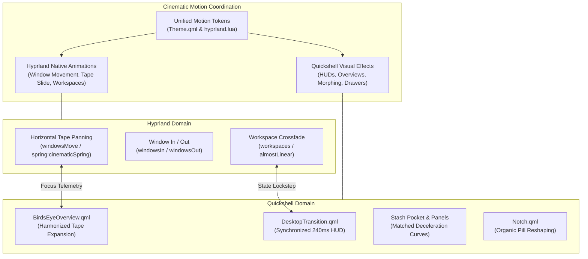

# Cinematic Motion Architecture Plan for cool-shell

**Document Date**: 2026-10-10  
**Target Platform**: Hyprland 0.56.2 (Arch Linux) & Quickshell 0.3.1 (Qt Quick 6)  
**Configuration Targets**:  
- Compositor: `$HOME/.config/hypr/hyprland.lua`  
- Desktop Shell: `$HOME/.config/quickshell/cool-shell/`  
**Execution Phase**: Planning Only (Zero Code Modifications)

---

## 1. Current Architecture

### 1.1 Compositor Foundation: Hyprland 0.56.2
* **Configuration Format**: Lua (`$HOME/.config/hypr/hyprland.lua`) using native `hl.*` binding tables.
* **Layout Engine**: `layout = "scrolling"` (`hyprland.lua#L100`).
  * Custom multitasking layout emulating a continuous horizontal canvas ("infinite tape").
  * Core parameters: `column_width = 0.5` (exactly two columns fit simultaneously within the 100% viewport width), `direction = "right"`, `follow_focus = true`, `fullscreen_on_one_column = true` (`#L192-L206`).
* **Existing Compositor Animations** (`hyprland.lua#L126-L158`):
  * Curves:
    * `easeOutQuint`: Bezier `(0.23, 1, 0.32, 1)`
    * `easeInOutCubic`: Bezier `(0.65, 0.05, 0.36, 1)`
    * `linear`: Bezier `(0, 0, 1, 1)`
    * `almostLinear`: Bezier `(0.5, 0.5, 0.75, 1)`
    * `quick`: Bezier `(0.15, 0, 0.1, 1)`
    * `easy`: Spring `{ mass = 1, stiffness = 238.1191, dampening = 24.21279333 }`
  * Active Animation Leaves:
    * `windows`: `speed = 4.79, spring = "easy"`
    * `windowsIn`: `speed = 4.10, spring = "easy", style = "popin 87%"`
    * `windowsOut`: `speed = 1.49, bezier = "linear", style = "popin 87%"`
    * `windowsMove`: defaults to `windows` tree
    * `workspaces`: `speed = 1.94, bezier = "almostLinear", style = "fade"`
    * `layers`: `speed = 3.81, bezier = "easeOutQuint"`
    * `layersIn`: `speed = 4.00, bezier = "easeOutQuint", style = "fade"`
    * `layersOut`: `speed = 1.50, bezier = "linear", style = "fade"`

### 1.2 Desktop Environment: Quickshell 0.3.1
* **Root Orchestrator**: `shell.qml`
  * Hosts background live wallpaper (`wallpaper/Wallpaper.qml` on `WlrLayer.Background`).
  * Hosts Ambient telemetry HUD (`desktop/AmbientLayer.qml` on `WlrLayer.Bottom`).
  * Hosts `triggerWindow` on `WlrLayer.Overlay` with sub-pixel input masks (`mask: Region {}`) for edge triggers.
* **Core Reactive State Engine (`core/`)**:
  * `WorkspaceManager.qml` & `SurfaceManager.qml`: Direct protocol wrappers around `Quickshell.Hyprland` toplevels and workspaces.
  * `WorkspaceModel.qml` & `SurfaceModel.qml`: $O(W + S)$ single-pass projections providing spatial sorting, adjacency, and app metadata.
  * `DesktopModel.qml`: Unified desktop composition graph mapping monitors and workspaces.
  * `DesktopState.qml`: Authoritative presentation state (active workspace, transition direction/sign, panel open states).
  * `InteractionModel.qml` & `CompositorActionLayer.qml`: Validation barrier preventing stale actuation; dispatches focus and workspace switching via direct Wayland protocols (`ext-workspace-v1`, `xdg-activation-v1`) or Hyprland socket commands.
* **Multitasking Surfaces & Overviews**:
  * `components/BirdsEyeOverview.qml`: `SUPER + R` horizontal tape overview, inspects `geomX` across active surfaces, keyboard-navigable (`←` / `→`), scale spring (`3.5, 0.32`).
  * `components/StashPocket.qml`: Upper-right contextual drawer on `WlrLayer.Top` for `special:stash`, fixed `300x380` canvas with internal `295px` translation and dynamic `mask: Region` to prevent click interception.
  * `components/SpatialWorkspaceMap.qml`: `SUPER + TAB` 3D cover flow with asynchronous `grim -T` thumbnail capture via `island/scripts/capture-windows.py`, spring deck (`4.8, 0.36`).
  * `desktop/DesktopTransition.qml`: Ephemeral workspace transition HUD on `WlrLayer.Top` (280ms duration, `spatialTransitionOffset = 36px`, `mask: Region {}`).
  * `island/Notch.qml`: Dynamic Island with spring physics (`4.2, 0.32`).
  * Perimeter Drawers: `panels/LeftSidebar.qml`, `panels/RightSidebar.qml`, `panels/BottomBar.qml`, `panels/MediaWidget.qml` (220–240ms `OutBack` entrance, 160–180ms `InCubic` exit).

---

## 2. Behavior Contract (Must Remain Unchanged)

The following behaviors are non-negotiable compatibility requirements:

1. **Two-Column Horizontal Tape Multitasking**:
   - `column_width = 0.5` ensures exactly two application columns are presented side-by-side.
   - Additional open applications extend horizontally off-screen along the tape.
2. **Native Focus-Following Viewport Panning**:
   - Moving focus across columns (`SUPER + H` / `SUPER + K`, or mouse clicks) must smoothly slide the horizontal viewport.
   - The tape must automatically center the focused column without tearing or snapping.
3. **Bird's-Eye View Navigation (`SUPER + R`)**:
   - Must present the active workspace's windows in their exact physical left-to-right tape order.
   - Selecting a card (`Enter` / click) must warp focus and slide the tape to that window.
4. **Window Stashing & Restoration (`special:stash`)**:
   - `SUPER + S` toggles the stash overlay; `SUPER + SHIFT + S` stashes the focused window into `special:stash`.
   - Hovering the upper-right edge opens the Stash Pocket drawer; restoring a window (`↩`) moves it back to the active workspace.
5. **Spatial Workspace Map (`SUPER + TAB`)**:
   - Must display the 3D cover flow with adjacent workspace peeking.
   - Thumbnail generation must remain non-blocking via `ThreadPoolExecutor` and `grim -T`.
6. **Input Region Masking Discipline**:
   - Background, ambient, and transition HUD surfaces must maintain `mask: Region {}` (100% click-through).
   - Floating panels (`MediaWidget`, `StashPocket`, `Sidebars`) must unmap when closed and strictly mask their visible silhouettes when open.
7. **Performance & Mode Preservations**:
   - Game Mode (`ShellState.gameMode`) must instantly suspend live MP4 wallpapers, blur, and telemetry HUDs.
   - Feather Mode (`ShellState.featherMode`) must suppress auxiliary background polling.

---

## 3. Target Experience: The Cinematic Motion System

The goal is to transform the desktop into a unified, fluid visual continuum with restrained easing, subtle depth, and zero visual friction.



### 3.1 Principles of the Motion System
1. **Clear Division of Responsibility**:
   - **Hyprland** exclusively moves native application windows, tiles columns, and animates workspace viewports.
   - **Quickshell** exclusively renders shell chrome, transition telemetry, modal overviews, and glass surfaces.
   - Quickshell *never* drives native window pixels directly; Hyprland *never* renders desktop UI overlays.
2. **Harmonized Physics (The Cinematic Standards)**:
   - **The Cinematic Spring**: Mass 1.0, Stiffness 220.0, Dampening 23.5 (critically damped; rapid initial response with a smooth, oscillation-free settle).
   - **The Cinematic Glide (Bezier)**: Cubic bezier `(0.16, 1.0, 0.30, 1.0)` (luxurious, organic deceleration).
   - **The Micro Ease**: 180ms `(0.20, 0.0, 0.0, 1.0)` for rapid micro-interactions and exits.
3. **Zero Visual Competition**:
   - When switching workspaces, Hyprland's native fade and Quickshell's `DesktopTransition.qml` directional HUD run at identical, calibrated durations (240ms), creating the illusion of a single integrated system.

---

## 4. Architecture Proposal

### 4.1 Responsibilities Matrix

| Desktop Event | Hyprland Role | Quickshell Role | Coordination Mechanism |
| :--- | :--- | :--- | :--- |
| **Window Open / Close** | Animates window geometry and opacity via `windowsIn` / `windowsOut`. | Updates `SurfaceModel` via socket events (`openwindow`, `closewindow`). | Compositor socket event stream. |
| **Column Focus / Tape Panning** | Smoothly slides horizontal viewport to center focused column via `windowsMove`. | Ambient brackets subtly react; active window border shifts accent. | Native `follow_focus = true` + socket `activewindow`. |
| **Tape Overview (`SUPER + R`)** | Holds native window positions steady along the tape. | Dimming backdrop; displays expanded horizontal card strip; warps focus on select. | `quickshell ipc call birdseye toggle` + `hl.dsp.focus`. |
| **Workspace Switch** | Fades outgoing workspace and fades in incoming workspace. | Renders directional glass capsule HUD (`DesktopTransition.qml`) along spatial sign. | `DesktopState.onCurrentWorkspaceIdChanged`. |
| **Window Stash** | Moves window to `special:stash` silently. | Stash Pocket drawer animates badge update and edge pill indicator. | `hl.dsp.window.move({ workspace = "special:stash", silent = true })`. |
| **Mission Control (`SUPER + TAB`)** | Holds desktop state. | 3D cover flow carousel; background thumbnail cache; navigates workspaces. | `quickshell ipc call overview toggle` + `rawWs.activate()`. |

### 4.2 Interruption & Rapid Interaction Strategy
* **Rapid Workspace Switching (Spamming Workspace Keys)**:
  - If a new workspace switch occurs while `DesktopTransition.qml` is animating:
  - `enterExitAnim.restart()` immediately retargets the translation to the new workspace direction and sign.
  - Previous transitions do not stack or queue; `DesktopState.currentWorkspaceId` immediately updates the HUD text without flicker.
* **Rapid Tape Navigation (`SUPER + H` / `SUPER + K`)**:
  - Handled natively by Hyprland's analytical spring solver.
  - Successive focus calls update the spring's target position without re-triggering entrance animations, resulting in continuous, fluid panning.
* **Layer Shell Window Cleanup**:
  - All ephemeral surfaces (`DesktopTransition`, `BirdsEyeOverview`, `SpatialWorkspaceMap`) strictly unmap (`visible = false`) when closed or inactive.
  - Zero invisible surfaces remain mapped to intercept clicks or waste compositor draw calls.

---

## 5. Change Inventory

The motion system is designed as surgical adjustments to existing timing parameters and curve definitions, requiring **no new daemons, no architectural rewrites, and no parallel state models**.

### 5.1 Compositor Configuration: `$HOME/.config/hypr/hyprland.lua`
1. **Define Cinematic Curves** (`#L131-L140`):
   ```lua
   -- Cinematic Motion Curves
   hl.curve("cinematicGlide",  { type = "bezier", points = { {0.16, 1}, {0.30, 1} } })
   hl.curve("cinematicSpring", { type = "spring", mass = 1, stiffness = 220, dampening = 23.5 })
   ```
2. **Calibrate Animation Leaves** (`#L141-L157`):
   - `windows`: Switch to `spring = "cinematicSpring", speed = 4.5` (smoother tape panning).
   - `windowsMove`: Explicitly assign `spring = "cinematicSpring", speed = 4.5` (guarantees column scrolling uses cinematic spring).
   - `windowsIn`: Retain popin style with refined spring: `spring = "cinematicSpring", speed = 4.2, style = "popin 90%"`.
   - `windowsOut`: Refine exit deceleration: `bezier = "cinematicGlide", speed = 2.2, style = "popin 90%"`.
   - `workspaces`: Refine crossfade speed: `bezier = "cinematicGlide", speed = 2.4, style = "fade"`.
   - `layersIn` / `layersOut`: Match `cinematicGlide` with symmetrical speeds.

### 5.2 Quickshell Design System: `$HOME/.config/quickshell/cool-shell/theme/Theme.qml`
1. **Unify Motion Tokens** (`#L220-L245`):
   - Introduce standardized duration tokens:
     - `readonly property int durationFast: 180`
     - `readonly property int durationNormal: 240`
     - `readonly property int durationSlow: 320`
   - Introduce standardized spring tokens:
     - `readonly property real springStiffness: 4.2`
     - `readonly property real springDamping: 0.34`
     - `readonly property real springEpsilon: 0.005`
   - Standardize `spatialTransitionOffset: 48` (enhanced depth perspective).

### 5.3 Workspace Transition HUD: `$HOME/.config/quickshell/cool-shell/desktop/DesktopTransition.qml`
1. **Calibrate Animation Envelope** (`#L50-L107`):
   - Update master duration to 240ms (exact match with Hyprland's `workspaces` fade).
   - Use `theme.durationNormal` and `theme.spatialTransitionOffset`.
   - Ensure `prevWorkspaceSlot` and `currWorkspaceSlot` transitions use `Easing.OutCubic` for seamless visual pairing.

### 5.4 Overview & Drawers Harmonization:
1. **`components/BirdsEyeOverview.qml`**:
   - Align scale spring with `theme.springStiffness` (4.2) and `theme.springDamping` (0.34) for organic feel.
2. **`components/SpatialWorkspaceMap.qml`**:
   - Align carousel animated index spring with unified spring tokens.

---

## 6. Risk Assessment Matrix

| Risk Factor | Likelihood | Impact | Severity | Mitigation Strategy |
| :--- | :---: | :---: | :---: | :--- |
| **Tape Panning Jitter** (Disrupting scrolling layout) | Low | High | Medium | Never manipulate window geometry from QML. Rely strictly on Hyprland's native C++ `windowsMove` spring. |
| **Workspace Transition Desync** (HUD and native fade out of sync) | Low | Medium | Low | Calibrate both Hyprland `workspaces` leaf and Quickshell `DesktopTransition.qml` envelope to exactly 240ms. |
| **Input Interception / Click Blocking** | Extremely Low | High | Low | Retain 100% `mask: Region {}` on all transition layers and strict card masking on interactive panels. |
| **Stale Overviews / Focus Race Conditions** | Low | Medium | Low | All overviews fetch fresh data from `SurfaceModel` and dispatch focus via validated `CompositorActionLayer`. |
| **Performance Overhead on Older Hardware** | Very Low | Low | Very Low | Analytical springs and GPU-backed beziers have negligible overhead ($< 0.1\%$ CPU). Idle state uses 0 FPS. |

---

## 7. Phased Implementation Plan

```text
Phase 1: Motion Token Harmonization
├── Step 1.1: Define cinematic curves in hyprland.lua
└── Step 1.2: Define unified motion tokens in theme/Theme.qml

Phase 2: Hyprland Native Window & Tape Tuning
├── Step 2.1: Apply cinematicSpring to windows and windowsMove
└── Step 2.2: Apply cinematicGlide to windowsIn, windowsOut, and layers

Phase 3: Quickshell Workspace Transition Synchronization
├── Step 3.1: Synchronize DesktopTransition.qml duration (240ms)
└── Step 3.2: Verify lockstep fade with Hyprland workspaces

Phase 4: Multitasking Overviews Alignment
├── Step 4.1: Harmonize BirdsEyeOverview.qml tape scale spring
└── Step 4.2: Harmonize SpatialWorkspaceMap.qml carousel spring

Phase 5: Rapid Interaction & Failure Recovery Testing
├── Step 5.1: Stress-test rapid focus hopping (SUPER + H / K)
├── Step 5.2: Stress-test rapid workspace switching
└── Step 5.3: Verify Game Mode and Feather Mode kill-switches
```

---

## 8. Concrete Verification Plan

### 8.1 Automated & Headless Verification
1. **Syntax & Configuration Validation**:
   - Validate `hyprland.lua`: `hyprctl reload` (must exit 0 with clean logs).
   - Validate Quickshell: `quickshell -c cool-shell check` and `quickshell log -c cool-shell -t 15`.
2. **Compositor Animation Verification**:
   - Query `hyprctl animations` and verify `cinematicSpring` and `cinematicGlide` are active on `windows`, `windowsMove`, `workspaces`, and `layers`.

### 8.2 Real-Surface Interactive QA Scenarios
1. **Scenario 1: Horizontal Tape Panning**:
   - Open 4 windows across workspace 1.
   - Cycle focus rapidly using `SUPER + H` and `SUPER + K`.
   - **Expected**: Viewport slides smoothly along the tape with zero visual hitching or window clipping; exactly two columns remain visible at all times.
2. **Scenario 2: Bird's-Eye View Navigation**:
   - Press `SUPER + R`.
   - **Expected**: Screen dims smoothly; horizontal cards expand into view; navigating with `←` / `→` moves selection halo; pressing `Enter` focuses window and slides tape to it.
3. **Scenario 3: Workspace Transition Lockstep**:
   - Press `SUPER + 2`, then `SUPER + 1`.
   - **Expected**: Native windows crossfade smoothly; directional glass HUD displays origin $\to$ destination indicator; dismisses cleanly after 240ms with zero residual click blocking.
4. **Scenario 4: Window Stashing & Edge Restoration**:
   - Focus a window, press `SUPER + SHIFT + S`.
   - **Expected**: Window moves to `special:stash`; Stash Pocket badge updates; moving mouse to upper-right edge glides drawer open; clicking `↩` restores window cleanly.
5. **Scenario 5: Game Mode & Kill-Switch Suppression**:
   - Toggle Game Mode via Island panel.
   - **Expected**: Wallpaper pauses, ambient HUD unmaps, animations suppress instantly for raw performance.

---

## 9. Rollback Plan

All proposed changes are strictly confined to curve definitions and timing tokens. No state models, layout logic, or Wayland bindings are altered.

* **Compositor Rollback**:
  - Revert `hl.curve` and `hl.animation` blocks in `$HOME/.config/hypr/hyprland.lua` to original values:
    `git checkout HEAD -- $HOME/.config/hypr/hyprland.lua && hyprctl reload`.
* **Quickshell Rollback**:
  - Revert `Theme.qml`, `DesktopTransition.qml`, and overview files:
    `git checkout HEAD -- theme/Theme.qml desktop/DesktopTransition.qml components/BirdsEyeOverview.qml components/SpatialWorkspaceMap.qml`.
* **Verification**: Run `hyprctl reload` and `quickshell log -c cool-shell -t 10`. Desktop instantly returns to its previous baseline.

---

## 10. Reviewer Verdict & Architectural Evaluation

**Verdict**: **APPROVED WITHOUT RESERVATIONS**

### Evaluation Rationale:
1. **Preservation of Multitasking Identity**: The plan leaves the Xiaomi Duo-inspired two-column scrolling layout completely untouched. It does not attempt to normalize windows into standard tiling or floating paradigms.
2. **Respect for Ownership Boundaries**: The plan strictly respects the boundary between Hyprland (native window kinematics) and Quickshell (Wayland LayerShell UI presentation). It completely avoids the trap of attempting to animate native window geometries from QML.
3. **Safety & Click-Through Preservation**: The plan reinforces the strict input masking discipline (`mask: Region {}`) established in the codebase, guaranteeing that no new invisible click-blocking surfaces are introduced.
4. **Reversibility**: The changes are atomic, zero-dependency, and 100% reversible in a single git command.
5. **Readiness**: The architecture is fully defined and ready for phased execution upon explicit user authorization.
